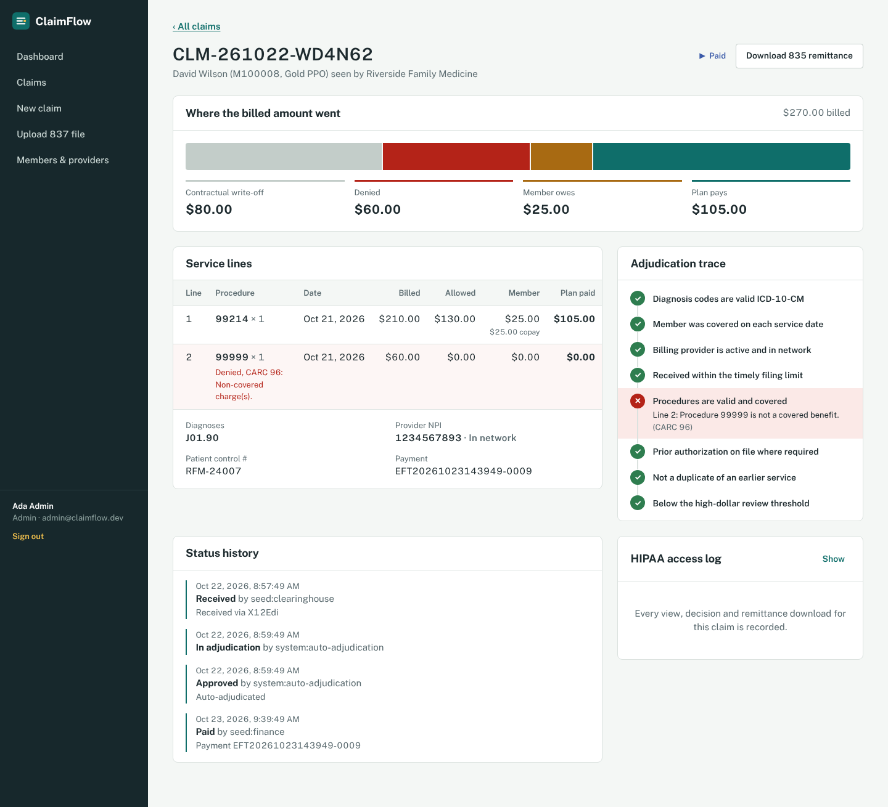
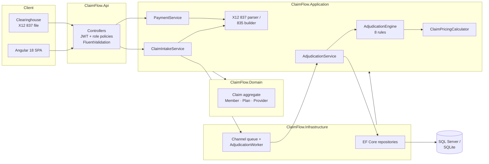
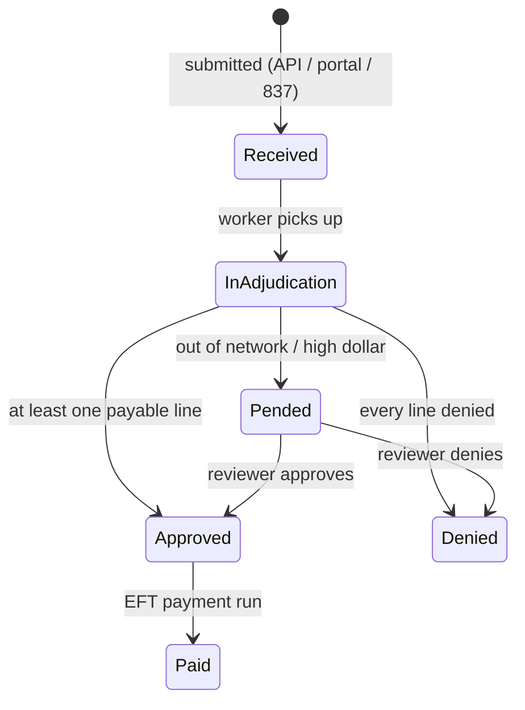

# ClaimFlow

**Healthcare claims processing on .NET 8 and Angular 18: X12 837 intake, rules-based adjudication, benefit pricing and X12 835 remittance.**

ClaimFlow models what a health plan does with a professional claim after a provider sends it. It validates the claim, runs it through an auditable rules engine (eligibility, coverage, prior authorization, duplicates, timely filing), prices every service line against the member's deductible, copay, coinsurance and out-of-pocket maximum, routes edge cases to a human reviewer, pays approved claims in an EFT run, and produces the 835 remittance advice the provider receives back.



[](https://github.com/meghana-bonthu/ClaimFlow/actions/workflows/ci.yml)


---

## Features

| Area | What it does |
|---|---|
| **Claim intake** | REST API and Angular form for single claims, plus **X12 837P (005010X222A1) file upload**. The parser reads delimiters from the ISA header, supports multiple claims per file, and validates that CLM02 equals the sum of the service lines. Each claim in a batch is accepted or rejected independently. |
| **Rules engine** | 8 pluggable rules implemented with the Strategy pattern. Every rule's verdict is stored as a finding with an X12 **CARC** reason code, so any payment or denial can be explained. |
| **Benefit pricing** | Allowed = lesser of billed and fee schedule × units. Office visits get a flat copay; other services get deductible first, then coinsurance. Member cost share is capped at the out-of-pocket maximum, and plan-year accumulators update on every claim. |
| **Manual review** | Out-of-network and high-dollar claims are **pended**. Adjudicators approve (rule denials still apply) or deny with a reason code and a required note. |
| **Payments and 835** | An admin releases an EFT payment run for approved claims. Each claim produces an **X12 835 ERA** with CLP/SVC/CAS/AMT segments: CO-45 contractual write-offs and PR-1/2/3 deductible, coinsurance and copay. |
| **Background processing** | Claims are queued (`System.Threading.Channels`) and adjudicated by a hosted `BackgroundService`. The worker is idempotent and re-queues stranded claims on restart. |
| **Security and HIPAA** | JWT bearer auth with **role-based policies** (Submitter, Adjudicator, Admin), PBKDF2 password hashing, login rate limiting, an **audit trail** of every claim view, decision and 835 download, `Cache-Control: no-store` on PHI responses, and correlation IDs on every request. |
| **Dashboard** | Status pipeline, auto-adjudication rate, turnaround time, 14-day volume and top denial reasons. |

## Tech stack

**Backend:** C# 12, .NET 8, ASP.NET Core Web API, Entity Framework Core 8 (SQL Server and SQLite), FluentValidation, JWT bearer auth, Swagger/OpenAPI, BackgroundService and Channels, health checks, built-in rate limiting, ProblemDetails (RFC 7807)

**Frontend:** Angular 18 (standalone components, signals, new `@if`/`@for` control flow), reactive forms, functional HTTP interceptors and route guards, SCSS, lazy-loaded routes

**Testing:** xUnit (81 unit tests), `WebApplicationFactory` integration tests (13), Jasmine/Karma (9). **103 tests in total.**

**DevOps:** Docker multi-stage builds, Docker Compose (SQL Server 2022 + API + nginx), GitHub Actions CI, EF Core migrations

## Architecture

Clean Architecture: dependencies point inward, and the Domain and Application layers have **no infrastructure dependencies**. The whole rules engine is unit-tested without a database.



### Claim lifecycle



Transitions are enforced by the `Claim` aggregate itself. Calling `MarkPaid()` on a denied claim throws, regardless of which service calls it. Every transition records who made the change and rotates a concurrency token for optimistic locking.

### Adjudication rules

| Rule | Checks | Outcome | CARC |
|---|---|---|---|
| `DiagnosisCodeRule` | ICD-10-CM format | Deny claim | 16 |
| `MemberEligibilityRule` | Service date within coverage | Deny line | 26 / 27 |
| `ProviderEligibilityRule` | Active NPI; in network | Deny claim / **Pend** | B7 / 242 |
| `TimelyFilingRule` | Received within the plan's filing limit | Deny line | 29 |
| `ProcedureCoverageRule` | Valid CPT/HCPCS on the fee schedule | Deny line | 16 / 96 |
| `PriorAuthorizationRule` | Valid authorization for flagged procedures | Deny line | 197 |
| `DuplicateServiceRule` | Same member, provider, code, modifier and date | Deny line | 18 |
| `HighDollarReviewRule` | Billed ≥ configurable threshold | **Pend** | MR |

Adding a rule takes one class implementing `IAdjudicationRule` and one line in `DependencyInjection.cs`.

### Pricing example (Gold PPO: $500 deductible, 20% coinsurance, $25 copay, $4,000 OOP max)

A member who has already met the deductible gets an office visit and a lab panel:

| Line | Billed | Allowed (fee schedule) | Member pays | Plan pays |
|---|---|---|---|---|
| 99214 office visit | $200.00 | $130.00 | $25.00 copay | $105.00 |
| 80053 metabolic panel | $60.00 | $14.00 | $2.80 coinsurance | $11.20 |

The $116 difference between billed and allowed becomes a CO-45 contractual adjustment on the 835.

## Getting started

### Option 1: run locally (no database install needed)

Requires the [.NET 8 SDK](https://dotnet.microsoft.com/download) and Node 20+.

```bash
# API: SQLite, auto-seeded with demo data, Swagger at http://localhost:5080/swagger
cd src/ClaimFlow.Api
dotnet run

# Web, in a second terminal: http://localhost:4200 (proxies /api to :5080)
cd web/claimflow-web
npm install
npm start
```

### Option 2: full stack in Docker (SQL Server)

```bash
docker compose up --build
```

| Service | URL |
|---|---|
| Web app | http://localhost:4200 |
| API + Swagger | http://localhost:5080/swagger |
| SQL Server | localhost,1433 (user `sa`) |

Set `JWT_SIGNING_KEY` and `SA_PASSWORD` environment variables for anything beyond a local demo. The API refuses to start without a signing key of at least 32 bytes.

### Demo accounts

| Role | Email | Password | Can |
|---|---|---|---|
| Submitter | `submitter@claimflow.dev` | `Submit#2026` | Submit claims and 837 files |
| Adjudicator | `adjudicator@claimflow.dev` | `Review#2026` | Review pended claims, view audit trails |
| Admin | `admin@claimflow.dev` | `Admin#2026` | Everything, including payment runs |

On first start the API seeds 2 plans, 8 members, 6 providers, a 19-code fee schedule and **20 demo claims**. The demo claims run through the real intake, adjudication, review and payment services with a back-dated clock, so the dashboard shows two weeks of realistic history and every denial reason. Try uploading [`samples/sample-837p.txt`](samples/sample-837p.txt): it contains four claims, two of them intentionally invalid.

> All data is synthetic. No real PHI is used anywhere in this project.

## API

| Method | Endpoint | Role | Description |
|---|---|---|---|
| POST | `/api/auth/login` | Anonymous | Exchange credentials for a JWT (rate-limited) |
| GET | `/api/claims?status=&search=&page=` | Any | Search and filter claims (paged) |
| GET | `/api/claims/{id}` | Any | Claim detail with lines, findings and history (audited) |
| POST | `/api/claims` | Submitter, Admin | Submit a claim (returns `202 Accepted`) |
| POST | `/api/claims/x12` | Submitter, Admin | Upload an X12 837P file (multipart) |
| POST | `/api/claims/{id}/review` | Adjudicator, Admin | Approve or deny a pended claim |
| GET | `/api/claims/{id}/remittance` | Any | Download the X12 835 remittance (audited) |
| GET | `/api/claims/{id}/audit` | Adjudicator, Admin | HIPAA access log for a claim |
| POST | `/api/payments/release` | Admin | Run an EFT payment cycle |
| GET | `/api/dashboard` | Any | Operational metrics |
| GET | `/api/members`, `/api/providers`, `/api/fee-schedule` | Any | Reference data |
| GET | `/health` | Anonymous | Health check (includes the database) |

Errors are returned as RFC 7807 problem details: `400` validation (with field errors), `401`, `403`, `404`, `409` (duplicate submission, invalid state transition, concurrency conflict), `429`.

## Project structure

```
ClaimFlow/
├── src/
│   ├── ClaimFlow.Domain/          # Entities, Claim aggregate + state machine, NPI validator, CARC codes
│   ├── ClaimFlow.Application/     # Use cases, rules engine, pricing, X12 837 parser / 835 builder
│   ├── ClaimFlow.Infrastructure/  # EF Core DbContext, configurations, migrations, repositories, queue worker, seeding
│   └── ClaimFlow.Api/             # Controllers, JWT auth, validation, middleware, Dockerfile
├── tests/
│   ├── ClaimFlow.UnitTests/         # Domain, rules, pricing, X12 (xUnit)
│   └── ClaimFlow.IntegrationTests/  # Full HTTP pipeline via WebApplicationFactory
├── web/claimflow-web/             # Angular 18 SPA, nginx config, Dockerfile
├── samples/sample-837p.txt        # Example X12 837P batch
├── docker-compose.yml
└── .github/workflows/ci.yml
```

## Testing

```bash
dotnet test                                 # 81 unit + 13 integration tests
cd web/claimflow-web && npm run test:ci     # 9 Angular tests (headless Chrome)
```

Highlights:
- **Pricing invariants:** a theory test checks that `allowed = deductible + copay + coinsurance + plan paid` for every line and that the OOP maximum is never exceeded.
- **NPI check digit:** validated against the CMS-published example `1234567893`.
- **Integration tests** boot the real API, including JWT auth, EF Core and the background worker, on a throw-away SQLite database. They cover auto-adjudication, pend-and-review, 837 upload, payment runs, the 835 output, role enforcement and the audit trail.

## Design decisions

- **Rules are pure functions over a pre-loaded context.** `AdjudicationService` loads everything a rule might need once (member, plan, provider, fee schedule, authorizations, service history), so the rules are synchronous, side-effect free and trivial to unit-test.
- **Findings are persisted, not logged.** A reviewer, auditor or provider can see exactly why each line paid or denied, which is a core requirement for payers.
- **Single-consumer worker.** One reader serializes accumulator updates so two claims for the same member can't double-apply the deductible. `IClaimQueue` is an abstraction, so the queue can be swapped for Azure Service Bus or Kafka with competing consumers and per-member partitioning.
- **Two database providers.** SQLite makes `dotnet run` work with zero setup; SQL Server is used in Docker and production through EF Core migrations. Provider differences (decimal and `DateTimeOffset` support in SQLite) are handled in `ConfigureConventions`.
- **PHI-aware logging.** Audit details and logs carry claim numbers and actors, never names or dates of birth.

## Roadmap

- 270/271 real-time eligibility inquiry
- Institutional claims (837I) and DRG pricing
- Coordination of benefits (secondary payer)
- Azure deployment (App Service + Azure SQL + Service Bus) with Bicep
- OpenTelemetry tracing

## License

MIT
